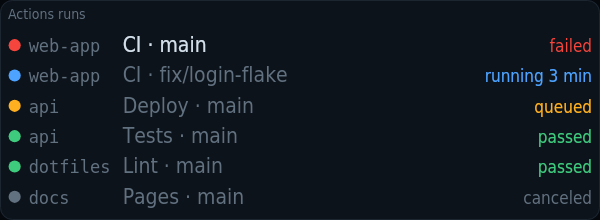
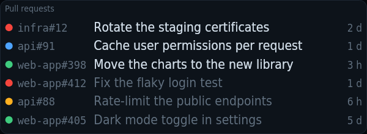

# kiosko-plugin-github

Your Actions runs, the pull requests waiting for your review and your own.

A plugin for [Kiosko](https://github.com/kiosko-lcd/kiosko), the widget mosaic for small USB LCD panels.



## Install

In Kiosko, **Plugins → Install from npm** → `kiosko-plugin-github`, then restart Kiosko. Or from a terminal:

```sh
npm install --prefix ~/.config/kiosko/plugins kiosko-plugin-github
```

(macOS: `~/Library/Application Support/Kiosko/plugins`, Windows: `%APPDATA%\Kiosko\plugins`.)

## Requirements

- [`gh`](https://cli.github.com) logged in (`gh auth login`), or a token in the source options: fine-grained with read access to Actions, Pull requests and Metadata, or classic with `repo` and `read:org` (plus `notifications` for the unread count). GitHub Enterprise Server: set the host.

## Widgets

### Actions runs — `github/actions`

Recent GitHub Actions workflow runs: broken first, then running (with a timer) and queued, passing last.


Uses: `github/activity`.

| Option | Type | Default | |
|---|---|---|---|
| `rows` | number | `0` | Rows. 0 = as many as fit. A number shows that many, in rows of a readable size (fewer when the tile is too small for them); the rest are counted in "+N more". |
| `layout` | `auto` \| `one-line` \| `detailed` | `"auto"` | Row layout. Automatic: the widget picks by the tile's shape. |
| `repos` | list | `[]` | Repositories. Empty: all. Names or patterns, comma-separated: * matches anything, a leading ! leaves out (web, acme/*, !*-old). |
| `branches` | list | `[]` | Branches. Empty: every branch. Names or patterns, comma-separated (main, release/*, !dependabot/*). |
| `hidePassing` | boolean | `false` | Hide passing runs. Only what is broken, running or waiting. |
| `onlyLatest` | boolean | `true` | Only the latest run per workflow and branch |
| `aliases` | map | `{}` | Short repo names. Repo (name or owner/name) → what to show, e.g. web-frontend → web. |

### Pull requests — `github/reviews`

Pull requests waiting for your review (whose, how long they have waited, how their checks are doing), then your own with what blocks them: failing checks, changes requested, approved. Mentions last, if you want them.



Uses: `github/activity`.

| Option | Type | Default | |
|---|---|---|---|
| `rows` | number | `0` | Rows. 0 = as many as fit. A number shows that many, in rows of a readable size (fewer when the tile is too small for them); the rest are counted in "+N more". |
| `layout` | `auto` \| `one-line` \| `detailed` | `"auto"` | Row layout. Automatic: the widget picks by the tile's shape. |
| `repos` | list | `[]` | Repositories. Empty: all. Names or patterns, comma-separated: * matches anything, a leading ! leaves out (web, acme/*, !*-old). |
| `includeMine` | boolean | `true` | Include my own pull requests |
| `includeMentions` | boolean | `false` | Include mentions. Needs mentions read in the source (Mentions read above 0). |
| `includeDrafts` | boolean | `false` | Include drafts |
| `hideApproved` | boolean | `false` | Hide approved pull requests |
| `aliases` | map | `{}` | Short repo names. Repo (name or owner/name) → what to show, e.g. web-frontend → web. |

### GitHub inbox — `github/inbox`

Three numbers: reviews waiting for you, failing runs and unread notifications (when the token can read them). Coloured only when they ask for you.


Uses: `github/activity`.

*No options.*

## Data sources

### GitHub activity — `github/activity`

Actions runs of your repos, your open pull requests and the ones you are asked to review, through a token or the gh CLI. Read every 2 min while a widget uses it. Options are set once in Kiosko → Settings → Data sources.

| Option | Type | Default | |
|---|---|---|---|
| `host` | string | `""` | GitHub host. Empty = github.com. A GitHub Enterprise Server host uses its /api/v3. |
| `token` | string | *(secret)* | Access token. Fine-grained token with read access to Actions, Pull requests and Metadata, or a classic one with repo and read:org (and notifications for the inbox count). Empty = use the gh CLI and its login. |
| `repos` | list | `[]` | Repositories for Actions. owner/repo. Empty = your most recently pushed repos. |
| `recentRepos` | number | `5` | Recent repos for Actions. Without a list of repositories: how many of your most recently pushed ones. Each costs one call per read. |
| `query` | string | `""` | Extra search qualifiers. Added to the pull request searches, e.g. org:acme or -repo:acme/old. Empty = everything you can see. |
| `runsPerRepo` | number | `10` | Runs read per repo |
| `maxMentions` | number | `10` | Mentions read. Open issues and pull requests that mention you, at most. 0 = don't look for mentions. |
| `bin` | string | `"gh"` | gh command |

## Development

```sh
npm install
npm test          # node:test
npm run check     # TypeScript
npm run build     # dist/index.js, what Kiosko loads
```

To try it in a running Kiosko without publishing: `kiosko plugins link .` and restart Kiosko.

Working on Kiosko and its plugins together: clone them side by side
(`kiosko/` and `kiosko-plugins/kiosko-plugin-github/`) and run `npm install` in
`kiosko/`; its workspaces link every plugin found in `../kiosko-plugins`.

## License

MIT
